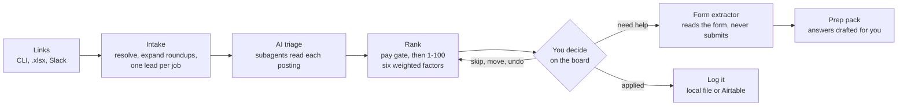
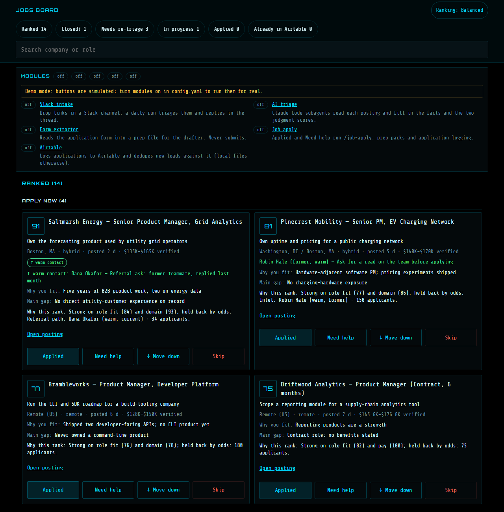
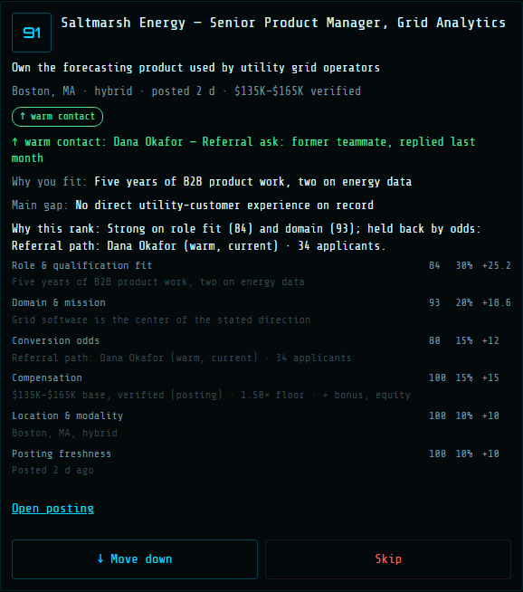
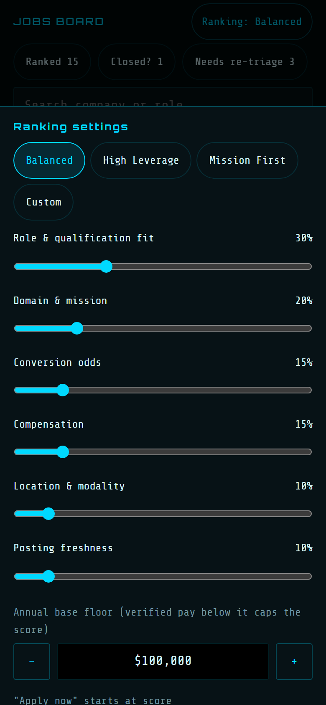

# job-search-copilot


A personal job-search pipeline. You drop in job links (a URL, a spreadsheet, a LinkedIn hiring post, a Slack
message). It resolves them into one lead per job, has AI subagents read each posting, and ranks every lead in two
stages: a hard gate on verified pay, then a 1-100 weighted score you can re-weight from your phone. When you want
to apply, it reads the application form and drafts answers. It never submits anything. You decide on every card,
and the system records what you decided.

**Status:** finished work sample, maintained on my own cadence. Extracted from a private multi-agent system; the
git history starts at extraction.

## Why this exists

I built this to run my own job search, and I still run it that way.

It started as a spreadsheet of 82 links and a batch of AI agents to triage them. The first run produced 86
triaged leads with no errors, and I still could not act on the result. 74 of the 82 links were LinkedIn hiring
posts, not job postings. The real link sat behind LinkedIn's "you're leaving" page, which the agents did not
follow, so 3 of the first 5 scores came from the post text alone. Roundup posts listing several roles had to be
split by hand. The fit rubric said 1 High, 28 Medium, 45 Low, while the list I wanted to apply to first had 11 rows,
picked on judgment the rubric did not encode. And the output was a table in a terminal, with nowhere to record a
decision.

So I changed the shape of the pipeline instead of the prompt. A script resolves and expands the links before any model sees them. The
model is asked for facts and exactly two judgments: how well I fit the role, and how much I want the domain.
Ranking runs in two stages. First a gate: if the top of the pay range a posting states is below my floor, the
score is capped.
Then a weighted score of six factors, four of them arithmetic on the extracted facts, so moving a weight or the
floor re-ranks the board on the spot with no model call. The ranked list lives on a phone-friendly board where
every tap can be undone for 90 seconds and is written down with what the card showed at the time.

The part I am most careful about is the application form. An earlier design let a model drive my logged-in
browser, and a security review showed a hostile job page could talk it into clicking or typing. The form is now read
by a deterministic extractor with no model in it, behind a network fence, with click rules where a deny word always
wins. It has read live Greenhouse, Lever and Ashby forms with zero submissions.

## What the system does end to end



Every stage is optional except the core (intake, ranking, the board). Each module is one switch in `config.yaml`:

| Module | What it adds | Needs |
|---|---|---|
| **core** | lead files, the ranking engine, the Jobs board, link and file intake | Python 3.11+, Node 18+ |
| `ai_triage` | subagents read each posting and fill in facts and two scores | Claude Code |
| `slack_intake` | post links in a Slack channel; a daily run triages them and replies in the thread | Slack bot token, `ai_triage` |
| `form_extractor` | reads a Greenhouse, Lever or Ashby form into a prep file | Playwright + Chromium |
| `job_apply` | the board's Applied and Need help buttons; the `/job-apply` and `/job-apply-fleet` skills | Claude Code |
| `airtable` | log applications to Airtable and dedupe new leads against it (local files stay the default) | an Airtable base |

The full flow, the data contract between each pair of stages, and what you lose by skipping each one are in
[docs/ARCHITECTURE.md](docs/ARCHITECTURE.md).

## How it works

**Ranking is a gate, then a score.**

- *Stage 1, the pay floor.* It is the only hard gate. If the top of a verified base range (printed on the posting
  or returned by the ATS) is below your floor, the composite is clamped to a ceiling, and the lead lands in Low
  with a lock and the reason on the card. Missing or unverified pay is flagged and scored on an estimated band,
  never clamped. Location never disqualifies a lead; it moves the score only through its weight.
- *Stage 2, a weighted score from 1 to 100.* Six factors. Role fit and domain are judgments: the triage model
  scores them and cites its evidence. Pay, location, posting freshness and the odds of converting are computed by
  formula from the extracted facts. Missing data counts as no signal, never as a penalty.

Because only the two judgments come from the model, a change to a weight, the floor or a band threshold re-scores
everything at once. It all happens in memory on the client, so the board re-orders while a slider moves, on a
phone too. Re-scoring and re-sorting 80 leads takes about 0.2 ms (the test fails above 5 ms).

**One scorer.** The formulas live in one JavaScript file that runs in the browser. Python reaches the same file
through Node and never re-implements a formula, and one golden fixture is checked by both test suites. Each card
shows **Why this rank**: the two factors that lifted it most and the one that held it back.

**One lead per job, one writer per field group.** A lead is a JSON file keyed by a hash of its canonical URL, so the
same job reached through a post, a roundup and a direct link is one lead. Intake writes the `intake` group, the
merge script writes `triage`, the board writes `decision`, and the store raises on any write outside the caller's
group. AI runs never edit a lead. They report back with one marker line.

**Triage in waves, merged by a script.** Subagents work in waves of 6, each writing one checkpoint file through a
manifest. The run asks before spending on more than 20 leads and stops if more than half fail. A script validates
each checkpoint against a schema and either merges it whole or marks the lead failed. The batch pattern is
published separately as [resumable-fanout](https://github.com/Josevventures/resumable-fanout).

**Undo before anything is final.** Every action stays pending for 90 seconds, and a sweeper executes it after the
window. A skip writes a log line with a snapshot of what the card showed, then deletes the lead. A skipped job is
never re-created.

**The form is read, never filled.** The extractor clicks only navigation controls on the posting's own host and
blocks every write request after the first page renders. The answers are drafted by a model with no browser, no
web and no shell, locked down per job by a settings file and a hook that is self-tested before every dispatch.

## Limits and non-goals

- **It never applies for you.** No submit, no sign-in, no auto-fill. That is the design, not a missing feature.
- **It does not find jobs.** You bring the links. LinkedIn posts are read from the public guest page only; a
  login-walled post is triaged from its text unless you connect a browser.
- **The score is not validated against outcomes.** I checked it by eye on 40 of my own leads. There is no
  agreement metric against a hand ranking, on purpose: I tried, and a rushed ranking of a small pool is not ground
  truth.
- **Triage is not free:** about 70K tokens per lead.
- **Single user, no authentication.** The board binds to localhost. Reach it from a phone only over a private
  network.
- **The two skills are prompts**, run by Claude Code. Their contracts with the code (flags, marker lines, the inbox
  line) are tested. What the model writes inside them is not.
- **Built and run on Windows.** CI runs on Ubuntu. The extractor's browser tests run where Chromium is installed and
  are skipped in CI.

## Install and run

```bash
git clone https://github.com/Josevventures/job-search-copilot
cd job-search-copilot
pip install -r requirements.txt
python -m copilot demo
```

`demo` copies 19 invented leads into a scratch folder and opens the board at `http://127.0.0.1:8420/jobs`. Your own
data goes in `data/` (gitignored):

```bash
cp config.example.yaml config.yaml
python -m copilot add https://job-boards.greenhouse.io/acme/jobs/123
python -m copilot serve
```

Per-module setup (Slack app scopes, Claude Code skills, Playwright, the Airtable base schema) is in
[docs/SETUP.md](docs/SETUP.md).

## Sample output

The demo board (invented leads), desktop:



One card with **Why this rank** open: each factor's score, weight, points and evidence.



Ranking settings on a phone: presets, six weights, the pay floor and the band thresholds. The board re-ranks as a
slider moves.



A Slack thread reply after the nightly run (format from `lib/slack_replies.py`; the content is invented):

```
Intake done [intake:final]
📋 roundup (3 roles): 2 on board — top: Saltmarsh Energy · Senior Product Manager (score 91); 1 screened
✅ Brambleworks · Product Manager, Developer Platform · Remote (US) · score 77
⚠️ Ironbark Data · Product Manager — couldn't read the posting (login wall / fetch error) — see the board card
```

## Build timeline

Dates are from the private repo's change log and commits.

| Date | Milestone |
|---|---|
| 2026-08-19 | First batch-triage skill: parallel subagents over a list of links |
| 2026-09-09 to 09-28 | The scheduled email scan that keeps my tracker current misses two emails, then writes one role's interview onto another role's record; matching moves from company to role |
| 2026-09-30 | First real batch: 82 links, 86 leads. Triage v2: intake script, roundups, screen, waves, checkpoints, one writer per field group |
| 2026-10-01 | The Jobs board with the 90-second undo. Browser-driven prep stopped by a feasibility spike and a security review; the extractor designed |
| 2026-10-02 | Form extractor merged after a read-only check on three live forms |
| 2026-10-03 | Terminal completion inbox: an interactive application reports back to its card |
| 2026-10-13 | Ranking engine: tiers replaced by a pay gate and a 1-100 score of six factors, one scorer, the settings drawer |
| 2026-10-14 | Calibration on 40 real leads; Slack intake live as a daily local task |
| 2026-10-15 | Acceptance on Greenhouse, Lever and Ashby with zero submissions; extracted to this repo |

## What I learned

- **Resolve before you reason.** The first batch scored LinkedIn posts instead of jobs. Following redirects and
  splitting roundups in plain code fixed more than a prompt change could have.
- **Judgment needs the model; arithmetic doesn't.** Two of the six factors come from the model. Pay, location,
  freshness and odds are formulas on extracted facts, so they can be explained, and they change when I move a
  slider, not when a prompt drifts. It is also why re-ranking costs nothing: no model call sits between the slider
  and the board.
- **Gate on one fact, score the rest.** Only verified pay below my floor can sink a lead. Unverified pay gets a
  flag and an estimate, and a job outside my home metro gets a lower location score, never a rejection. A strong
  role in a relocation hub can still score near the top.
- **A hand ranking is not ground truth.** I ranked a set of roles by hand to calibrate the score, then decided that
  a quick ranking of a small pool should not be the test. The golden fixtures check the formulas. Whether the order
  is right is my call on the board.
- **Unattended means the safety lives in code.** Nobody watches the nightly run or approves each step of a prep
  dispatch. The extractor's fence, the drafter's lockdown and the wrapper that owns Slack exist because
  instructions are not enough. A hook that cannot run fails open, so it is tested before every dispatch.
- **Keep the state out of the model's hands.** Lead files have one writer per group, AI runs answer with a marker
  line, and the Slack wrapper trusts a result file, never the model's summary.
- **A silent failure costs more than a loud one.** A keyword query that missed two emails, and a sync that wrote to
  the right company but the wrong role, both reported success. The nightly run here writes a heartbeat before it
  does anything and records how every run ended, so a failure shows up instead of passing as done.

## Origin

Extracted on 2026-10-15 from the private multi-agent system I use day to day, where the board is one tab of a
personal dashboard and the skills run alongside others for research, writing and scheduling. The history starts
at extraction. What changed in extraction is listed at the end of
[docs/DESIGN-DECISIONS.md](docs/DESIGN-DECISIONS.md): sample values in place of my own, home metros made
configurable, an optional local store instead of Airtable-only logging, and the private integrations removed.

## Tests

```bash
pip install -r requirements-dev.txt
python scripts/run_tests.py
```

Four pytest suites plus the Node tests for the scorer and page logic: 1,030 tests, 56 of which need a browser. The
fixtures are invented or scrubbed (see `prep_extract/tests/fixtures/README.md`). CI installs only the core
requirements, so the extractor's browser tests are skipped there with a reason. They run locally once Playwright's
Chromium is installed.

## License

MIT, see [`LICENSE`](LICENSE).
