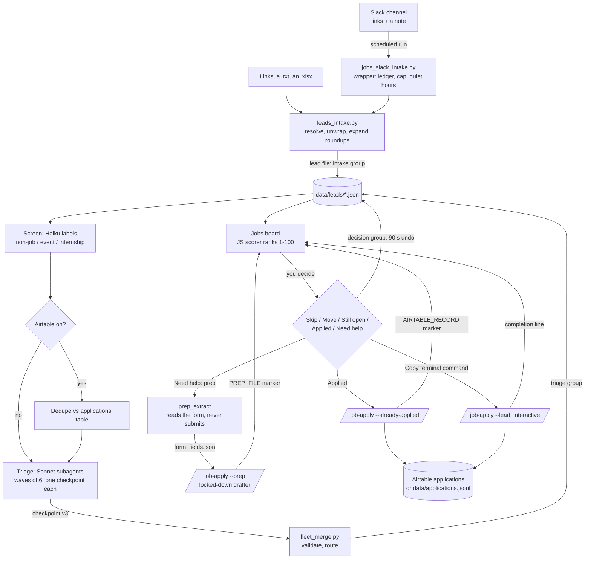

# Architecture

The pipeline is a set of stages that talk to each other through files on disk, never through each other's
memory. Each stage has one job, writes one thing, and can be left out. This page walks the full flow, the data
contract between each pair of stages, what each stage needs, what you lose by skipping it, and where a person
decides.

Code comments cite sections of the private design specs this was built from ("ranking-engine spec §4.4",
"ruling C2"). The specs themselves are not published; the decisions they record are in
[DESIGN-DECISIONS.md](DESIGN-DECISIONS.md).

## The flow

## The one rule everything follows: one writer per field group

A lead is one JSON file, `data/leads/<lead_id>.json`. The lead id is the first 12 hex characters of the SHA-256
of the canonical URL, so the same job reached through a post, a roundup and a direct link is one file. The file has
three groups, and each group has exactly one writer. `lib/lead_store.py` enforces it: an update that names a field
outside its group raises.

| Group | Written only by | Holds |
|---|---|---|
| `intake` | `leads_intake.py` | every source the lead arrived through (URL, kind, poster, roundup parent, hint, the Slack note), the post text, the screen label |
| `triage` | `fleet_merge.py` | everything a triage subagent found, plus `triage_status`, `route`, `triaged_at`, `batch_id` |
| `decision` | the board backend (`board/jobs.py`) | what you decided, the pending action, job status, prep file, record id, band override, full history with a snapshot of what the card showed |

Every write takes a per-file lock (5 s wait, stale after 30 s), writes a temp file and renames it over the target.
Dispatched jobs (`/job-apply` runs) never edit a lead file. They report back with one marker line in their
output, and the board writes the result.

## Stage by stage

### 1. Intake (core)

`skills/job-apply-fleet/leads_intake.py` (or `python -m copilot add ...`). Input: URLs as arguments, a text file,
or an `.xlsx` (hyperlinks are read too). For each URL:

- Unwrap LinkedIn's `safety/go`, `redir/redirect` and `cold-join` wrappers, and follow short links (`lnkd.in`,
  `bit.ly`, `t.co`).
- Canonicalize: strip tracking parameters, keep functional ones.
- A LinkedIn post is fetched from the public guest page. A post with three or more distinct links that resolve to
  job-looking URLs is a roundup and becomes one lead per link, each remembering its parent post and the text just
  before its link as a hint. A post with one job link becomes a lead on the posting URL. A post with no link becomes
  a lead on the post itself, keeping the post text. A login-walled post still becomes a lead.
- A job you skipped on the board is never re-created (`previously_skipped`), so you never pay to re-triage it.
- **Per-URL error isolation:** each URL, and each child of a roundup, runs inside its own `try`. A failure is
  recorded against that URL; the rest continue. The exit code is 4 only when every URL failed, so an unattended
  caller can tell "nothing worked" from "partial".

Output: lead files with the `intake` group filled and `triage.triage_status: "pending"`.

### 2. Screen and dedupe (AI triage module; Airtable optional)

A Haiku call labels each unscreened lead `job`, `event`, `non_job` or `internship_or_undergrad`. It fails open: if
the call fails, nothing is screened out. With the Airtable module on, the applications table is read once and any
lead whose canonical URL is already there is routed `airtable` without being triaged.

**Skip it** and every link goes to triage, including event pages and internships (they cost a subagent each).

### 3. Triage (AI triage module)

`fleet_wave.py` builds a manifest of the leads to triage and hands them out in waves of 6. Each Sonnet subagent
follows `subagent_prompt.md`: a fixed fetch ladder for the job description (the links, then the ATS JSON APIs,
then X's public API, then a browser for login walls, then a careers-page search, then the post text alone with
`jd_read: false`), then facts and two judgment scores, written as one checkpoint file. Above 20 leads it stops and
asks before spending (about 70K tokens per lead). If more than half of a batch fails, it stops.

**The checkpoint contract (v3)** is validated by `lib/checkpoint.py` before anything is merged:

| Kind | Fields |
|---|---|
| facts | `company`, `role_title`, `location`, `locations[{label, metro}]`, `modality`, `relocation_assistance`, `level`, `job_summary`, `posting_status` |
| pay | `pay`, `pay_type`, `pay_bands[{location_metro, min, max, period, basis}]`, `pay_source` (`posting` / `ats_api` / `none`), `bonus`, `equity` — only figures printed on the posting; never estimated |
| freshness and odds inputs | `posted_date`, `posted_date_source`, `reposted`, `applicant_count`, `inbound`, `network.contacts[{name, title, status, warmth, recommendation}]`, `airtable_match` |
| judgment | `scores.role_fit` and `scores.domain`, each `{score 0-100, evidence ≤160 chars}`, plus `main_gap` |
| bookkeeping | `fetch_method`, `jd_read`, `jd_note`, `fit_score` / `fit_rationale` (information only) |

A malformed checkpoint marks the lead `failed` with the problems listed; it is never partially merged.

**Skip it** (AI triage off): links you add sit in **Needs re-triage** with no score. A triage subagent only writes a
checkpoint file, so you can write one by hand in the same shape and run `fleet_merge.py --batch <id>`; that is the
whole contract.

### 4. Merge and route (core)

`fleet_merge.py` validates every checkpoint, writes the `triage` group and assigns a route with
`lib/routing.py` (first match wins): `airtable` (same role already applied), `screened`, `closed` (posting closed;
you confirm it on the board), `board`. The route only decides which section a lead appears in. It does not rank.

### 5. Rank: the board (core)

`board/web/jobs_scoring.js` is the only implementation of the score. It runs in the browser, so the board re-ranks
on every slider move; Python reaches it through `board/scoring_bridge.py` (a Node subprocess) and never
re-implements a formula. A shared golden fixture is asserted by both the JS and the Python suites.

Six factors, each 0-100, weighted, summed and rounded to a 1-100 composite:

| Factor | From | Notes |
|---|---|---|
| Role & qualification fit | `scores.role_fit` (LLM) | judgment |
| Domain & mission | `scores.domain` (LLM) | judgment |
| Conversion odds | network, inbound, pipeline, applicant count | baseline 30; best contact signal only |
| Compensation | verified pay band vs your floor; else a market band by level, shrunk toward neutral | |
| Location & modality | best listed location vs your home metros | never a disqualifier |
| Posting freshness | posted date (or first seen), reposted, recruiter signal | closed = 0 |

The pay floor is the only hard gate: when the top of a **verified** base range is below your floor, or the posting
itself says equity-only or unpaid, the composite is capped (default 40) and the card shows a lock. Unverified pay
is never gated. Leads still in the old (v1) shape show **Needs re-triage** and no score at all: a made-up score
would look authoritative and be wrong.

Bands: **Apply now**, **Worth a look**, **Low**, by two thresholds; validation keeps every capped lead in Low. Each
card has **Why this rank** (the two largest contributors and the biggest drag) and a full factor breakdown.

**Scoring config** (`data/scoring_config.json`, written only by the board): `active_weights`, presets,
`compensation_settings.annual_base_floor` and `hard_gate_clamp_ceiling`, `bands`, `market_bands` per level,
`home_metros`, and a `version` for optimistic concurrency (a stale second tab gets a 409 and keeps its edits).
Until the first save, the defaults in `jobs_scoring_config.py` apply. They are invented samples.

### 6. Decide (core; you)

Every action on a card is first written as `decision.pending` with `execute_after = now + 90 s`. A sweeper thread
runs every 5 s and executes due actions. **Undo** works inside the window. Nothing irreversible (a file delete, a
dispatch, an Airtable write) happens before the window closes, and because the pending action is in the lead file,
a restart cannot lose it.

| Action | Effect |
|---|---|
| Skip (reason chip + note) | one line in `data/leads/_skips.jsonl` (with a snapshot of what the card showed), then the lead file is deleted |
| Move up / Move down / Reset | a band override, one band per tap; the real score stays visible |
| Still open | for a **Closed?** card; holds only for the triage you answered |
| Applied | dispatches `/job-apply --already-applied` (job_apply module) |
| Need help → Draft prep pack | form extractor, then the locked-down drafter (job_apply module) |
| Need help → Copy terminal command | copies `/job-apply <url> --lead data/leads/<id>.json` for an interactive run |

Every decision row carries a snapshot (shown score, rank, computed and chosen band, config version and weights)
so the decisions can later be used to check or tune the weights.

### 7. Form extractor and prep packs (form_extractor + job_apply modules)

**Step 1, the extractor** (`prep_extract/`): a plain subprocess, no AI. Greenhouse first (its public board API
returns the questions as JSON), then the Lever or Ashby DOM adapter, then a generic DOM adapter. Headless Chromium
with a fresh profile behind a network fence:

- every non-GET navigation is aborted, and after the first page renders every non-GET request of any kind;
- top-frame navigation off the posting's host is aborted, every hop of a redirect chain is re-checked, WebSockets
  and Workers are blocked;
- a control is clicked only if it is a button, link or tab, its label matches `next|continue|save and
  continue|next step|step N`, and it matches no deny word (`submit`, `apply`, `sign in`, `upload`, `confirm`,
  `agree`, … and single-sign-on provider names). Deny always wins; non-ASCII look-alike labels are denied;
- it never types, uploads, submits, signs in or accepts terms. A sign-in wall is recorded, not crossed.

Output, `data/prep/_forms/<lead>-<stamp>.json` (`form_fields.json` schema v1): `questions_visible`,
`sign_in_required`, `pages[].fields[]` (`label`, `type`, `required`, `max_chars`, `max_words`, `options`,
`help_text`, `label_missing`), `cover_letter.mode`, `resume`, `click_log`, `unseen_pages`, `errors`. Every string
is NFKC-normalized, stripped of control and zero-width characters and length-capped. The extractor never fails the
job: on a crash or a 180 s timeout the board writes a stub and the drafter falls back to a standard question set.

**Step 2, the drafter**: one headless `/job-apply --prep <lead> --form <file>` run, locked down by a per-job
`--settings` file the board writes: a deny list (shell, web, browser, agents, mail, every Airtable write) plus a
PreToolUse hook on every tool that allows reads only inside the data dir and the skills, the profile file by exact
path, and writes only `.md` files directly in `data/prep/`. A hook that cannot run fails open in Claude Code, so
the board runs the hook with a known-deny and a known-allow event before every dispatch and refuses to dispatch if
either answer is wrong. The drafter treats every form string as untrusted data.

Output: `data/prep/<company>-<date>.md` (form map, answers within each field's limit, cover letter, open
questions) plus a frozen `.draft.md` twin, and the marker line `PREP_FILE: data/prep/<file>.md`.

**Skip the extractor** and prep still works: the drafter gets a stub and writes the standard set (why this
company, why this role, experience, salary, work authorization). **Skip job_apply** and the Applied and Need help
buttons are hidden; the board still ranks, skips, moves and undoes.

### 8. Apply and log (job_apply module; Airtable optional)

`/job-apply` (prompt-only Claude Code skill) runs intake, the network check, question answering, submission
confirmation and logging. Headless runs end with one marker line the board parses:

- `PREP_FILE: data/prep/<file>.md` — must resolve inside the prep folder and exist; a `.draft.md` is never accepted.
- `AIRTABLE_RECORD: rec<14>` or `AIRTABLE_RECORD: local-<12 hex>` — the record the application was logged as.

An interactive run started from a card (`--lead`) appends one line to `data/terminal_completions.jsonl` after
logging; the board applies it on its next list load if, and only if, the lead is in terminal progress, nothing is
pending, and no job is running (otherwise it waits and re-checks). Applying a line is idempotent, so a lost
sidecar only means every line is re-checked once.

With the Airtable module on, the record is written to your applications table (schema in SETUP.md). Off, it is
one line in `data/applications.jsonl`. The local form is the one addition this extraction makes to the private
system's contract; see the judgment calls in DESIGN-DECISIONS.md.

### 9. Slack intake (slack_intake + ai_triage modules)

`jobs_slack_intake.py` is a deterministic Python wrapper; the model never touches Slack. Per run:

1. Read the channel's last 14 days. A top-level message you wrote is a drop; thread replies are not.
2. Ingest new messages, and new links in edited messages. The message text is saved on the lead as your note
   (context for triage, never a score input by itself).
3. Queue pending leads, earlier nights first, up to 20; the rest carry to the next run. Workday postings are
   prefetched by Python (JS-only pages; https, `*.myworkdayjobs.com` only, GET only, 15 s, 2 MB cap) because the
   headless run has no network tool of its own.
4. One `claude -p` run does screen, dedupe, triage and merge, with an explicit tool allowlist (no mail, no
   calendar, no Airtable writes, no git). The wrapper trusts the run's `result.json` and the lead files, never its
   prose.
5. After quiet hours, reply in each message's thread: one line per link with its score, or why it is not on the
   board. A final reply carries `[intake:final]`; before posting, the wrapper looks for its own marker in the thread,
   so a crash between posting and recording can never produce a duplicate.

The ledger, `data/leads/_slack_intake.jsonl`, is append-only: ingested → replied (partial) → replied (final), plus
retry and refund rows. A failed triage gets one automatic retry and one per re-drop; a retry counts when it is
queued, and is refunded if the whole run failed. Health: a heartbeat before anything else, every exit recorded,
one alert in the channel for an unhandled crash, a run that never finished, or no successful night two nights in
a row.

**Skip it** and nothing changes downstream: drop links with `python -m copilot add` or `/job-apply-fleet`.

## Where a person decides

| Point | Decision |
|---|---|
| Triage over 20 leads | spend the tokens or not (interactive runs) |
| The board | skip with a reason, move a band, confirm a closed posting, mark applied, ask for prep |
| Ranking settings | the weights, the pay floor, the band thresholds |
| Prep pack | every answer is yours to edit; nothing is ever submitted |
| `/job-apply` | you submit the application yourself; the skill logs it only after you say you did |

## Files at a glance

| Path | What |
|---|---|
| `copilot/` | config loader and `python -m copilot` (demo, serve, add, modules) |
| `board/` | FastAPI server, the board backend (`jobs.py`), scoring config, dispatch, prep lockdown, `web/` page and scorer |
| `skills/job-apply-fleet/` | intake, triage waves, merge, Slack wrapper, `lib/` (lead store, routing, checkpoint schema, Slack, ATS fetch), the skill and subagent prompts |
| `skills/job-apply/SKILL.md` | the application skill (prompt-only) |
| `prep_extract/` | the form extractor |
| `samples/` | 19 invented leads for the demo board and the script that generates them |
| `data/` | your data (gitignored): `leads/`, `prep/`, `reports/`, `.state/` |
